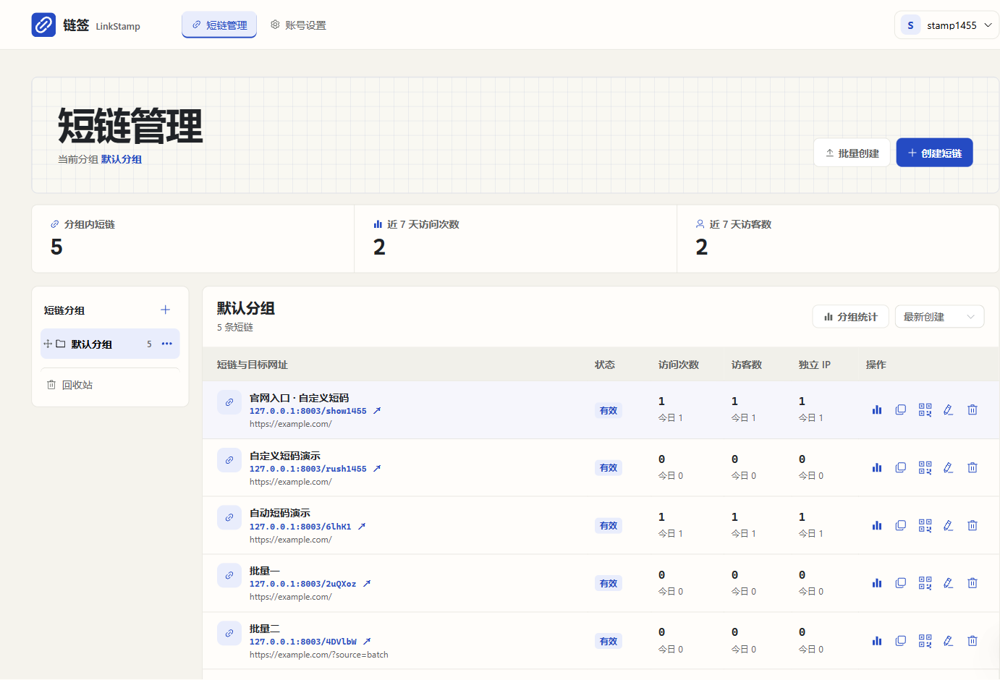
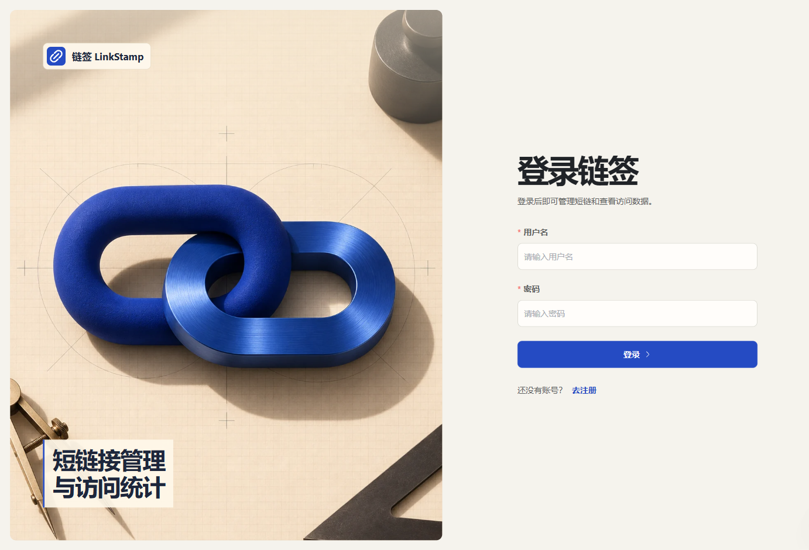
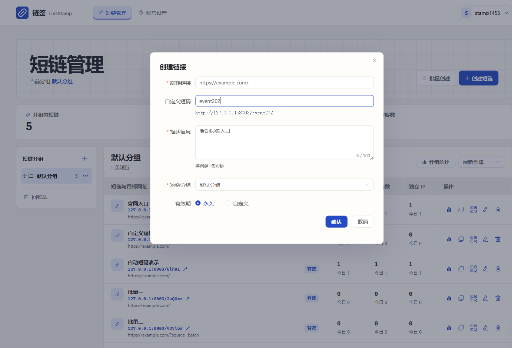
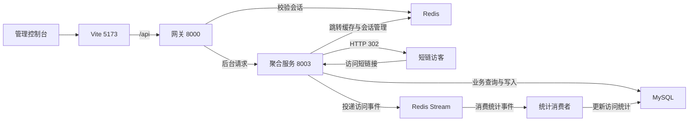

<!-- LinkStamp changes: project documentation and local setup. -->
# 链签 LinkStamp｜短链接管理与访问统计

<p align="center">
  
  
  
  
  
  <a href="LICENSE"></a>
</p>

链签把长网址变成可分享、可追踪的短链接。在一个工作台里完成创建、分组管理和二维码分享，按单条链接或分组查看访问数据。

[项目预览](#项目预览) · [核心功能](#核心功能) · [系统设计](#系统设计) · [本机启动](#本机启动) · [实测结果](#实测结果)

## 项目预览

登录后进入短链工作台。左侧切换分组和回收站，主区域展示短链列表和访问概况。点击列表中的统计入口，可以查看访问趋势和明细。



| 登录与注册 | 自定义短码 |
| --- | --- |
|  |  |

## 核心功能

| 功能 | 使用方式 |
| --- | --- |
| 创建与分享 | 单条创建可自动生成短码，也可输入 `demo2026` 一类的自定义短码并即时预览。批量创建自动生成短码，结果可下载为 Excel。每条短链都可以复制网址或下载二维码。 |
| 分组与有效期 | 注册后自动创建默认分组。短链可移动到其他分组，并设为永久有效或指定到期时间。 |
| 回收站 | 移入回收站会暂停跳转，恢复后可继续访问有效的链接。彻底删除后仍保留短码占用，避免已分享的网址跳到新内容。 |
| 访问统计 | 按日期查看单条短链或分组的 PV（访问次数）、UV（独立访客）与独立 IP 数。统计面板还提供访问趋势、设备与浏览器分布、访问明细。 |

自定义短码允许 3–8 位小写字母或数字，首位必须是字母。`api`、`page`、`actuator` 和 `error` 是系统保留字。

## 系统设计



### 管理请求与短链跳转

- 管理控制台的 `/api` 请求由 Vite 转发给网关。网关为需要登录的请求查询 Redis 会话，再把请求交给聚合服务。管理端负责账号和分组权限，短链业务模块负责创建、跳转和统计。
- 访客直接访问聚合服务的短链路径。服务优先查 Redis，缓存未命中时，通过路由表 `t_link_goto` 查到分组 ID，再按分组查询 `t_link` 分表。有效链接返回 HTTP 302，浏览器根据响应中的 `Location` 打开原始网址。

### 短码并发与缓存回填

- 短链记录和路由记录在同一事务写入。`t_link_goto.full_short_url` 的唯一索引保证同一域名下的短码唯一，重名时返回「该短码已被占用」。
- 自定义短码创建与跳转回填使用同一把 Redisson 锁，创建完成后首次访问可查库并回填 Redis。跳转还使用布隆过滤器和空值缓存，减少无效短码触发的数据库查询。
- 管理端校验分组归属，Sentinel 为单条短链创建接口限流。本机默认每秒 20 次，可通过 `SHORTLINK_CREATE_QPS` 调整。
- 创建或编辑时可以根据目标网址的域名填充建议描述。服务端校验网址格式，生成描述时只提取域名。

### 异步访问统计

跳转时将访问事件写入 Redis Stream。统计消费者从 Stream 读取事件，再写入访问明细和汇总数据。PV 按请求计数，UV 使用访客 Cookie 区分，独立 IP 单独统计。地区查询默认关闭，开启方式见[运行数据](#运行数据)。

## 技术栈

| 层次 | 技术 | 用途 |
| --- | --- | --- |
| 前端 | Vue 3、Vite、Element Plus、ECharts | 短链工作台、表单、统计图表 |
| 后端 | Java 17、Spring Boot 4.0.9、Spring Cloud Gateway 5、MyBatis-Plus、Sentinel | 管理 API、会话校验、短链跳转与限流 |
| 数据 | MySQL 8.0、ShardingSphere 5.5 | 保存账号、分组、链接与访问统计，并对主要业务表分片 |
| 缓存与异步 | Redis、Redisson、Redis Stream | 会话、跳转缓存、分布式锁、访问事件 |

## 本机启动

以下以 Windows PowerShell 和 IntelliJ IDEA 为例。准备 JDK 17、Maven、Node.js 24、MySQL 8.0 和 Redis。前端、网关和聚合服务默认监听 `127.0.0.1`。

| 组件 | 示例端口 | 用途 |
| --- | --- | --- |
| Vite | `5173` | 控制台与登录入口 |
| 网关 | `8000` | 管理 API 的统一入口 |
| 聚合服务 | `8003` | 管理业务与短链跳转 |
| MySQL | `13307` | 数据库，按实际实例填写 |
| Redis | `16380` | 会话、缓存和访问统计消息 |

### 1. 初始化数据库

启动 MySQL 和 Redis。在 MySQL 新建名为 `linkstamp` 的空库，字符集使用 `utf8mb4`，再为项目创建一个有读写权限的用户。用具备建表权限的账号从项目根目录导入 [初始化 SQL](resources/database/link.sql)。

```powershell
mysql.exe -h 127.0.0.1 -P 13307 -u root -p --default-character-set=utf8mb4 linkstamp -e "source resources/database/link.sql"
```

### 2. 生成本地配置

首次启动时，在项目根目录执行下面的命令。

```powershell
.\scripts\New-LocalShardingConfig.ps1 -DbPassword (Read-Host -AsSecureString 'MySQL password')
```

脚本根据[配置样例](resources/sharding-local.example.yaml)生成 `.runtime/sharding.yaml`。默认数据库用户是 `linkstamp`，可以用 `-DbUrl` 和 `-DbUser` 覆盖连接地址和用户名。已有本地配置时直接复用。若从 ShardingSphere 5.3 迁移，先备份配置，再按新版样例迁移规则，并沿用原有连接信息和加密密钥。

若 Redis 使用其他地址或端口，在两个后端运行配置中设置 `SHORTLINK_REDIS_HOST` 和 `SHORTLINK_REDIS_PORT`。Redis 有密码时，设置 `SPRING_DATA_REDIS_PASSWORD`。

### 3. 启动后端

用 IDEA 打开项目根目录并导入 Maven 模块，选择 JDK 17。

1. 运行 `AggregationServiceApplication`，等待聚合服务监听 `8003`。
2. 运行 `GatewayServiceApplication`，等待网关监听 `8000`。

两个运行配置的工作目录都设为项目根目录。网关默认使用 `aggregation` 配置，直连聚合服务。

<details>
<summary>在终端打包和启动后端</summary>

从项目根目录运行 Maven 打包命令。

```powershell
mvn.cmd -pl aggregation,gateway -am clean package
```

打开两个终端，分别运行下面两条命令。两个终端都以项目根目录为工作目录。

```powershell
java -jar .\aggregation\target\shortlink-aggregation.jar
java -jar .\gateway\target\shortlink-gateway.jar
```

先启动聚合服务，再启动网关。

</details>

### 4. 启动前端

从项目根目录进入前端目录，安装锁文件指定的依赖并启动 Vite。

```powershell
cd .\console-vue
npm.cmd ci
npm.cmd run dev -- --host 127.0.0.1 --port 5173 --strictPort
```

打开[本地登录页](http://127.0.0.1:5173/login)。首次使用时自行注册，系统会自动创建默认分组。可以用 `https://example.com` 创建一条自定义短链，点击验证跳转，再回到工作台查看访问统计。前端生产构建使用 `npm.cmd run build`。

### 常见问题

| 现象 | 检查方法 |
| --- | --- |
| IDEA 报主类找不到 | 检查是否导入了根目录的 Maven 工程。Windows 下项目路径含中文时，在运行配置的「缩短命令行」中选择「JAR 清单」。 |
| 页面能打开，登录请求失败 | 检查 `8000` 和 `8003` 是否都已启动，再核对聚合服务的数据库配置、Redis 地址和端口。 |
| 修改短链地址后，预览与实际不一致 | 将聚合服务的 `SHORTLINK_DOMAIN` 与 `console-vue/.env.local` 中的 `VITE_SHORTLINK_DOMAIN` 设为相同的主机和端口，重启对应服务。 |
| 地区图表没有数据 | 本机配置默认关闭地区查询。普通访问统计仍可使用。 |

## 目录结构

```text
linkstamp/
├── console-vue/  # Vue 管理控制台
├── gateway/      # 管理 API 路由与会话校验
├── aggregation/  # 本机后端启动入口，加载 admin 和 project
├── admin/        # 账号、分组和管理 API
├── project/      # 短链创建、跳转、回收站及访问统计
├── resources/    # 建表 SQL 和本地分片配置样例
├── scripts/      # 本地配置生成脚本
└── docs/         # 界面截图
```

## 运行数据

初始化 SQL 只建表。仓库截图使用演示账号和 `example.com`，实际账号、运行日志和数据库文件保存在本机。密码使用带随机盐的 PBKDF2 哈希，手机号和邮箱由 ShardingSphere 加密存储。

控制台通过请求头传递登录信息。Redis 会话保存网关所需的用户标识和显示名。异常日志的请求地址只记录路径。

访问统计记录访客 IP、浏览器、设备类型和访问时间。地区查询默认关闭。显式配置 `SHORTLINK_AMAP_KEY` 后，统计消费者会向高德 IP 定位服务发送访客 IP。

## 实测结果

以下场景在本地构建和运行中验收。

| 场景 | 结果 |
| --- | --- |
| 注册、登录与分组权限 | 注册后出现默认分组。另一账号提交该分组 ID 时，创建被拒绝。 |
| 自动与自定义短码 | 两种短码都能返回 HTTP 302；非法字符、长度和保留字被拒绝。 |
| 并发创建 | 两个账号同时提交同一个短码，只有一个成功。核对 16 张短链分表与 16 张路由分表，两类记录各只有一条。 |
| 异步统计 | 访问后 PV 和 UV 写入成功，可从列表查询。 |
| 回收站 | 移入回收站后停止跳转，恢复后可再次跳转，彻底删除后短码仍被占用。 |
| 兼容性与界面 | 框架升级后验证了旧账号、加密的手机号和邮箱、已有短链。浏览器验证了登录失败提示、二维码、批量创建与 Excel 导出、统计、回收站恢复和退出，并在 390 像素宽视口检查工作台与账号设置。 |

## 开源许可

[Apache License 2.0](LICENSE) · [NOTICE](NOTICE)
